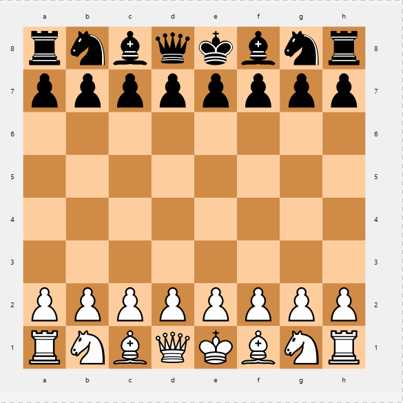

# Chess Engine

A chess engine written from scratch in Java, with no libraries. It plays complete, legal games of chess, either against you in a terminal or inside a chess GUI such as Cute Chess or Arena.



## What it does

- Generates every legal move, including castling, en passant and promotions. Each candidate move is made on the board and kept only if it doesn't leave the mover's king in check.
- Searches with negamax alpha-beta and iterative deepening. Captures are tried first, and a quiescence search keeps looking at captures past the depth limit so the engine doesn't stop in the middle of a trade.
- Caches search results in a transposition table keyed by a Zobrist hash, so a position reached through a different move order is looked up instead of searched again. The same hash is used to detect repetitions.
- Evaluates positions by material plus piece-square tables, with a separate king table for the endgame.
- Opens from a small book of 38 mainline openings, picked at random, so games don't all start the same way.
- Manages its clock with a normal time target per move, and spends extra time only while its best move is still changing between search depths.
- Speaks the UCI protocol, so any standard chess GUI can run it.

## Testing

Move generation is checked with perft, which counts every position reachable from a starting position to a fixed depth and compares the total against published reference counts. All six standard test positions from the [Chess Programming Wiki](https://www.chessprogramming.org/Perft_Results) match to depth 5.

| Position | Depth 5 nodes | Result |
|---|---:|:---:|
| Start position | 4,865,609 | ✓ |
| Kiwipete | 193,690,690 | ✓ |
| Position 3 | 674,624 | ✓ |
| Position 4 | 15,833,292 | ✓ |
| Position 5 | 89,941,194 | ✓ |
| Position 6 | 164,075,551 | ✓ |

That is 480,105,445 positions in total, at about 10 million positions per second on one core.

The transposition table cut the work needed to reach the same depth. At depth 6, the start position went from 933,981 nodes to 272,303, and Kiwipete went from 1,111,517 to 655,533.

`SelfTest` also checks that make and unmake restore every position exactly, and plays through all 38 book lines to make sure none contains an illegal move.

To run the tests after building, use `java -cp bin engine.PerftTest 5` and `java -cp bin engine.SelfTest`.

## Running it

You need Java 17 or newer.

Download `chess-engine.jar` from the [Releases](../../releases) page, or build it yourself with `build.bat` on Windows or `sh build.sh` on Mac and Linux.

### In a chess GUI

In Cute Chess, Arena or another UCI GUI, add a new engine with this command, and set the working directory to the folder the jar is in.

```
java -jar chess-engine.jar
```

On Windows you can point the GUI at `chess-engine.bat` instead.

### In a terminal

```
java -cp chess-engine.jar engine.Play            # you play white
java -cp chess-engine.jar engine.Play black      # you play black
java -cp chess-engine.jar engine.Play 5000       # engine thinks 5 seconds a move
```

Moves are typed as the starting square and the ending square, like `e2e4`, or `e7e8q` to promote to a queen. Castling is typed as the king's move, like `e1g1`. The other commands are `moves`, `fen`, `undo` and `quit`.

## Code layout

| File | What it does |
|---|---|
| `Board.java` | Board state, make and unmake move, undo stack |
| `Move.java` | Moves packed into a single int (from, to, flags) |
| `MoveGen.java` | Legal move generation and attack detection |
| `Fen.java` | Reading and writing positions in FEN notation |
| `Perft.java`, `PerftTest.java` | Move generation tests against reference counts |
| `SelfTest.java` | Make/unmake and opening book checks |
| `Eval.java` | Position evaluation |
| `Search.java` | Alpha-beta search, quiescence search, move ordering, time management |
| `TranspositionTable.java` | Cache of search results by position |
| `Zobrist.java` | Position hashing |
| `Book.java` | Opening book |
| `Uci.java` | UCI protocol for chess GUIs |
| `Play.java` | Terminal play mode |

## How it was built

I built this with Claude Code as an AI pair programmer. The commit messages explain the design decisions and the bugs found along the way.

## Next steps

- Play engine-vs-engine matches to measure how much each change actually adds in strength.
- Better ordering for quiet moves, such as killer moves and the history heuristic.
- A larger opening book read from a Polyglot file.
